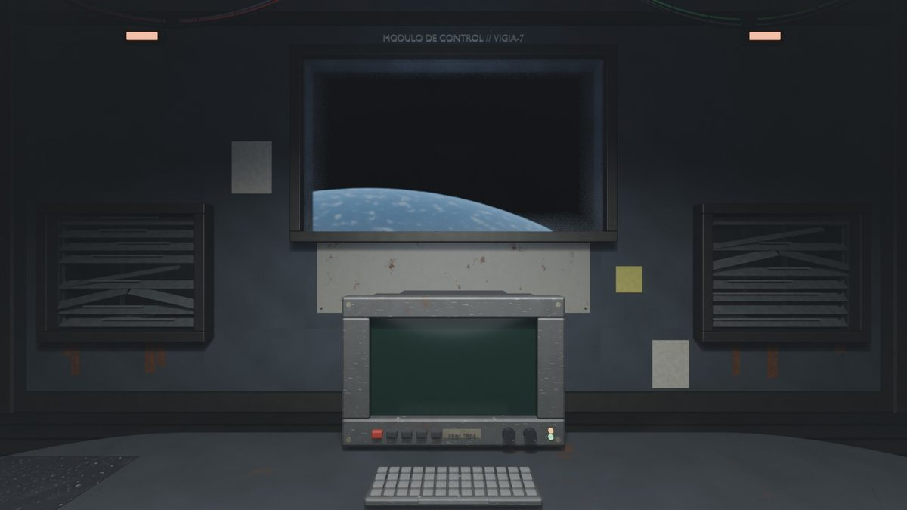

# VIGÍA-7

<div class="crt" markdown>
MÓDULO DE CONTROL · ESTACIÓN VIGIA-7<br>
TURNO: 12:00 AM – 6:00 AM · CÁMARAS: 10/10 EN LÍNEA<br>
&gt; _
</div>

**Vigía-7** es un *fan game* de terror por noches, inspirado en *Five Nights at Freddy's*, ambientado en una **estación espacial abandonada**. Eres el vigilante del turno de noche: desde la oficina del Módulo de Control vigilas las cámaras, cierras las compuertas, controlas el reactor y mantienes la temperatura de la Criogenia mientras los experimentos que salieron mal intentan llegar hasta ti.

Esta web documenta el desarrollo del juego: **qué se añadió en cada versión**, cómo es **la nave** (la oficina y las cámaras) y **los personajes**, con todas sus versiones.


*La oficina tal y como está en la versión actual: la consola, el ventanal sobre el planeta y las dos rejillas de ventilación.*

## El juego en cifras

| Dato | Valor |
|---|---|
| Versiones publicadas | **129** (de la v0.1 a la v1.38) |
| Tiempo de desarrollo | 21 días (del 13 de octubre al 2 de noviembre de 2026) |
| Noches | 1, 2, 2.5, 3, 3.5, 4 (rutas A y B), 5, 6, 7 y el final |
| Cámaras | 10 salas + 7 conductos de ventilación |
| Criaturas | 7 enemigos, 1 aliado y 4 finales distintos |
| Tecnología | HTML5 Canvas + JavaScript puro, sin dependencias |

## Cómo se ha hecho

- **Programación:** JavaScript puro sobre un `<canvas>` de HTML5. Nada de motores ni librerías.
- **Gráficos:** las salas, la oficina y las criaturas se modelan **por código** con scripts de Python para *Blender* y se renderizan como imágenes (`.jpg` y `.webp`).
- **Voces y sonido:** las cintas se generan con voces sintéticas (*edge-tts*) y los efectos con `ffmpeg`.
- **Distribución:**
    1. Un `.exe` para Windows (con *PyInstaller* y *pywebview*).
    2. Una versión web para **itch.io**.
    3. Una versión en **GitHub Pages** que se actualiza con un solo script.

!!! info "¿Dónde se puede jugar?"
    - En el navegador, desde [GitHub Pages](https://paugarciaperez071108-coder.github.io/vigia-7/).
    - En [itch.io](https://pawerestudios-coder.itch.io/vigia-7), en Windows, Mac o LliureX.

## Cómo arrancarlo en local

El juego usa un servidor propio **sin caché**, para que el navegador no mezcle archivos de versiones distintas:

```bash
cd Vigia-7/programa
python servidor.py
# después, abrir http://localhost:8001
```

!!! warning "No uses `python -m http.server`"
    Ese servidor deja que el navegador guarde los módulos en caché. Al actualizar el juego se mezclaban archivos viejos y nuevos y salía una **pantalla negra al cambiar de cámara** (el fallo que arregló la [v0.5](historial/v0-1-a-v0-30.md)).

## Controles básicos

| Acción | Tecla |
|---|---|
| Compuerta izquierda / derecha | ++q++ / ++e++ |
| Luz izquierda / derecha | ++a++ / ++d++ |
| Subir o bajar el monitor | ++space++ o ++s++ |
| Cambiar de cámara | ++1++ … ++9++ y ++0++ |
| Temperatura de la cápsula (CAM 05) | ++arrow-up++ / ++arrow-down++ |
| Enfriar el reactor (CAM 04) | ++r++ |
| Escribir en la consola | ++enter++ → comando → ++enter++ |

!!! tip "Consejo para la primera noche"
    Si la cápsula de la Criogenia se vacía, **vigila los pasillos y cierra la puerta**. El Congelado corre por las cámaras hasta tu compuerta.

## Qué hay en esta web

<div class="grid cards" markdown>

-   :material-history: **[Historial de versiones](historial/index.md)**

    Las 129 versiones, una a una, con lo que se añade en cada una.

-   :material-monitor: **[La oficina](nave/oficina.md)**

    Cómo ha cambiado el Módulo de Control desde la primera versión hasta la oficina hecha entera en Blender.

-   :material-cctv: **[Las cámaras](nave/camaras.md)**

    El plano de la nave y las diez salas que se vigilan, con el antes y el después.

-   :material-skull: **[Personajes](personajes/index.md)**

    Cada criatura con su mecánica y todas sus versiones de diseño.

</div>
