# Las cámaras

Desde el monitor de la oficina se vigilan **diez salas** de la nave y, desde la noche 2, **siete conductos de ventilación** (V1–V7). Se cambia de cámara con las teclas ++1++ … ++0++ o haciendo clic en el minimapa.

## El plano de la nave

La nave es un anillo que pasa por la oficina y el reactor, más un callejón que va del Laboratorio a la Criogenia:

```text
[01 Hangar]─[10 Comunic.]─[08 C. Este]──┐
    │                                  │ der.
[09 Enferm.]─[04 REACTOR]─[06 Comedor]  OFICINA (+ pasillo central detrás)
                  │            │        │ izq.
            [02 Laborat.] [03 Invern.]  │
                  │            │        │
            [05 Criogen.] [07 C. Oeste]─┘
```

## Las diez salas

Desde la **v0.54** cada cámara está en una esquina alta, mirando hacia abajo con lente angular, y cada sala tiene su propio color de luz.

| CAM | Sala | Luz | Qué pasa aquí |
|---|---|---|---|
| 01 | Hangar | Amarillo sodio | Pasarela, puente grúa y una lanzadera desmontada |
| 02 | Laboratorio | Verde | El muro de contención de **El Espécimen** |
| 03 | Invernadero | Magenta | Enredaderas secas bajo la luz de cultivo |
| 04 | Reactor | Violeta | El núcleo; desde aquí se **enfría** con ++r++ |
| 05 | Criogenia | Cian | La cápsula de **El Congelado** y el panel de temperatura |
| 06 | Comedor | Naranja | Solo quedan dos lámparas encendidas y una mesa volcada |
| 07 | Corredor Oeste | Rojo de emergencia | Lleva a la compuerta izquierda |
| 08 | Corredor Este | Blanco frío | Lleva a la compuerta derecha |
| 09 | Enfermería | Blanco de quirófano | Camillas, cortinas y la rejilla arrancada |
| 10 | Comunicaciones | Turquesa | Servidores, uno caído, y una pantalla rota |

## Galería

<div class="galeria" markdown>
<figure markdown>
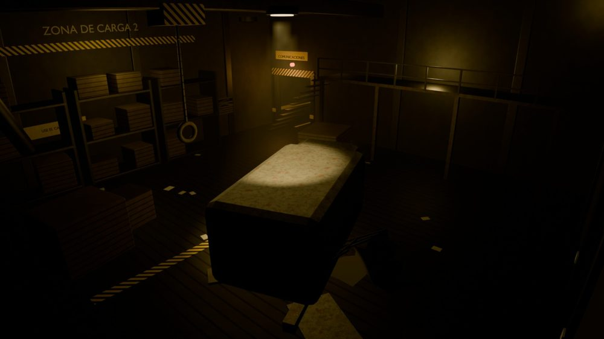
<figcaption>CAM 01 · Hangar</figcaption>
</figure>
<figure markdown>
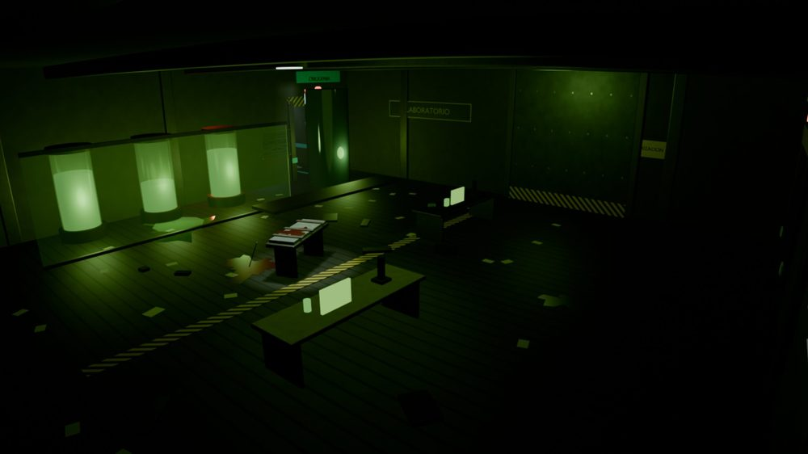
<figcaption>CAM 02 · Laboratorio</figcaption>
</figure>
<figure markdown>
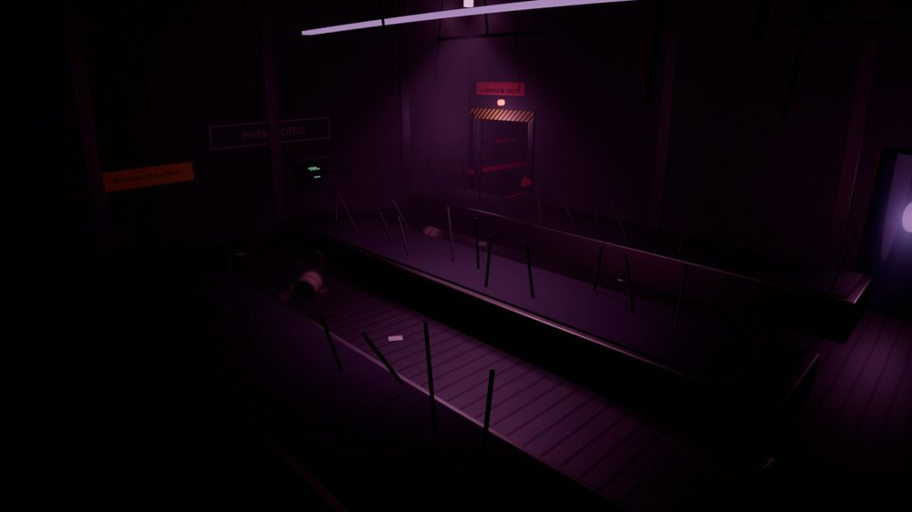
<figcaption>CAM 03 · Invernadero</figcaption>
</figure>
<figure markdown>
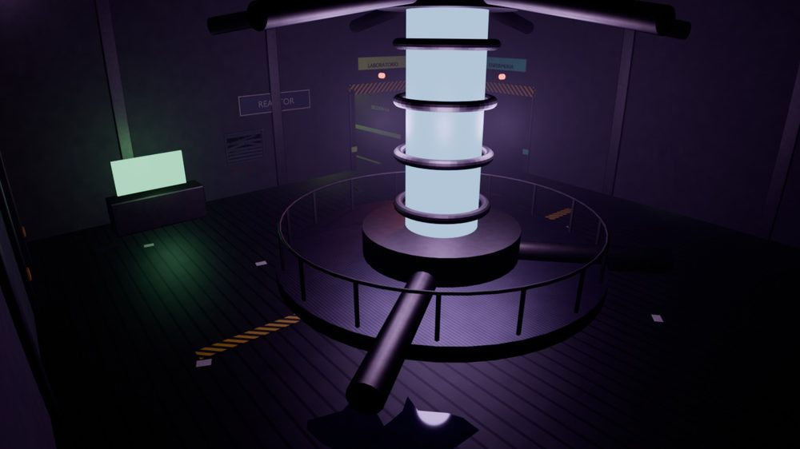
<figcaption>CAM 04 · Reactor</figcaption>
</figure>
<figure markdown>
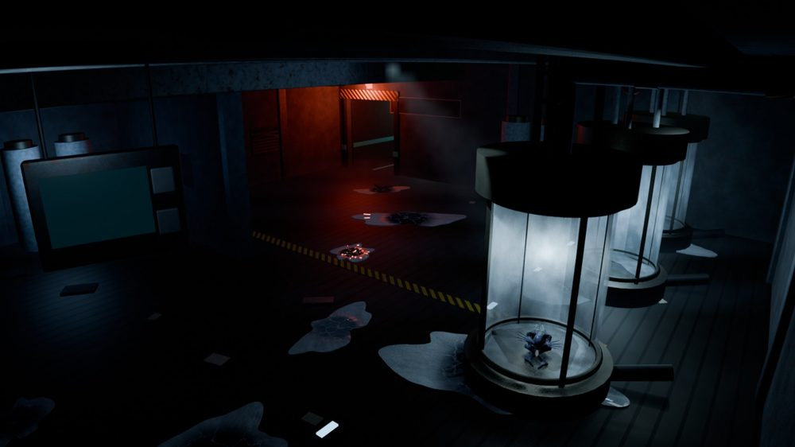
<figcaption>CAM 05 · Criogenia</figcaption>
</figure>
<figure markdown>
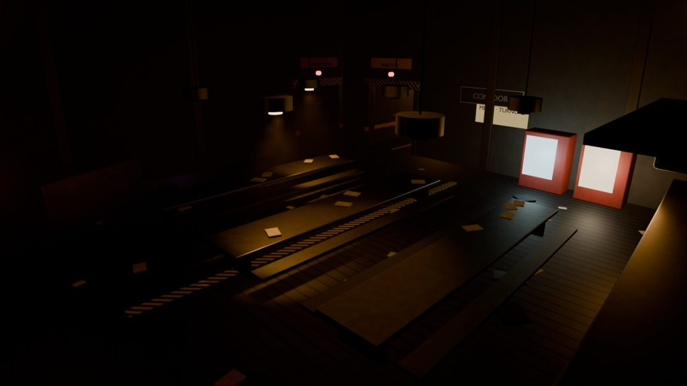
<figcaption>CAM 06 · Comedor</figcaption>
</figure>
<figure markdown>
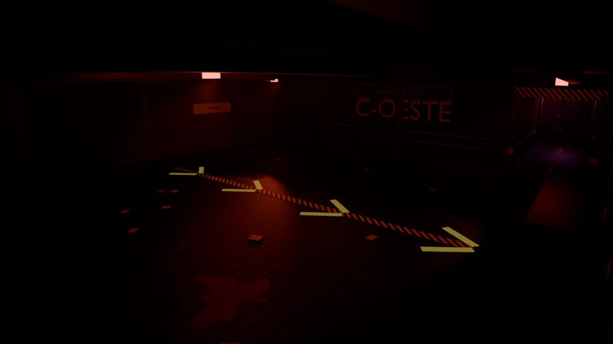
<figcaption>CAM 07 · Corredor Oeste</figcaption>
</figure>
<figure markdown>
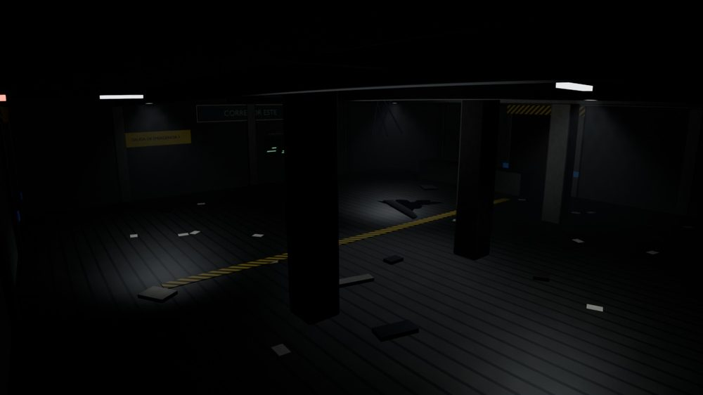
<figcaption>CAM 08 · Corredor Este</figcaption>
</figure>
<figure markdown>
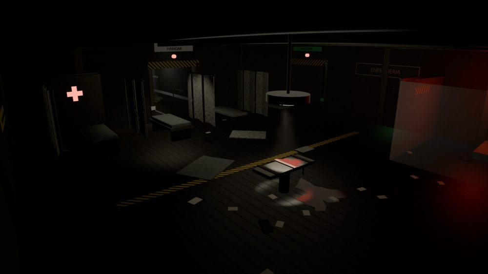
<figcaption>CAM 09 · Enfermería</figcaption>
</figure>
<figure markdown>
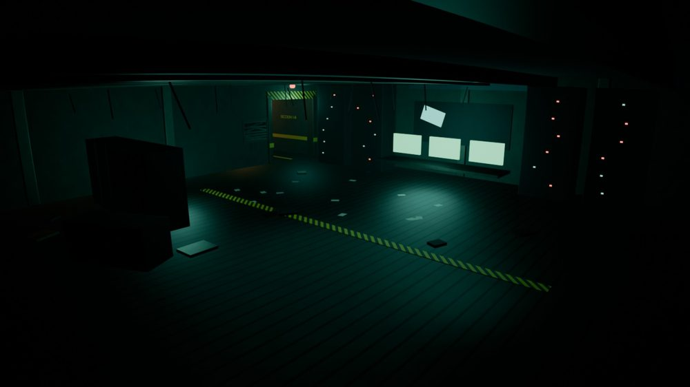
<figcaption>CAM 10 · Comunicaciones</figcaption>
</figure>
</div>

## Las cámaras cambian durante la noche

Algunas cámaras tienen varias imágenes según lo que esté pasando:

<div class="galeria" markdown>
<figure markdown>
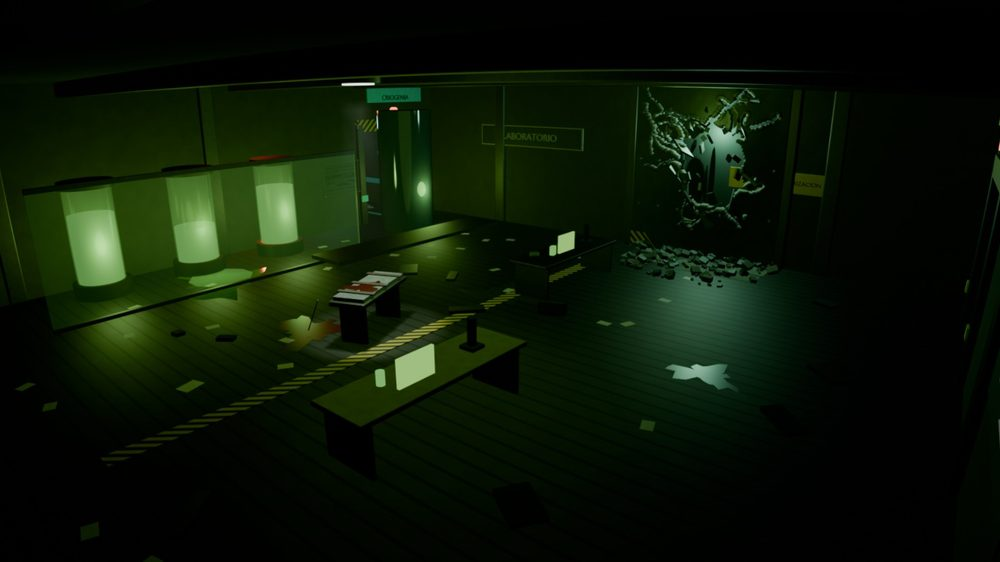
<figcaption>CAM 02 · El muro de El Espécimen, reventado</figcaption>
</figure>
<figure markdown>
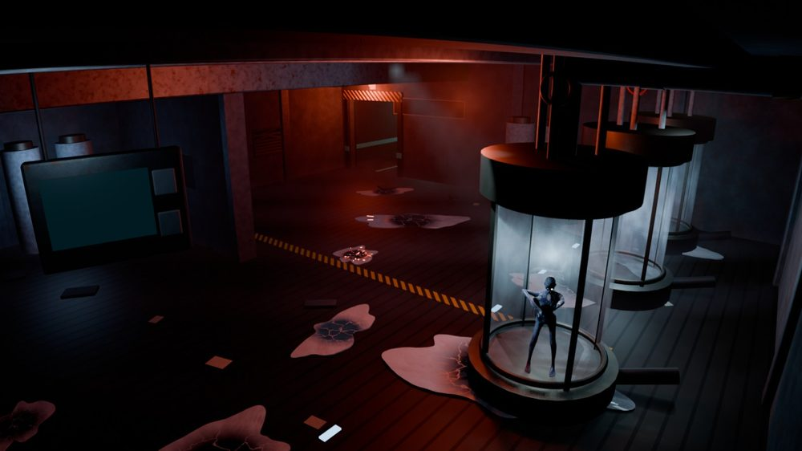
<figcaption>CAM 05 · El Congelado saliendo de la cápsula</figcaption>
</figure>
</div>

!!! danger "Cuidado con la CAM 05"
    Si la temperatura de la cápsula sale del rango que pide (por ejemplo, «NO BAJAR DE −21 °C»), suena una alarma de 20 segundos y **El Congelado sale corriendo** hacia una de las dos compuertas.

## Los conductos de ventilación

Desde la **noche 2** el monitor tiene un segundo plano, el de los conductos (se cambia con ++tab++). Solo V6 y V7 llegan a la oficina, y solo en esas dos se puede echar insecticida.

<div class="galeria" markdown>
<figure markdown>
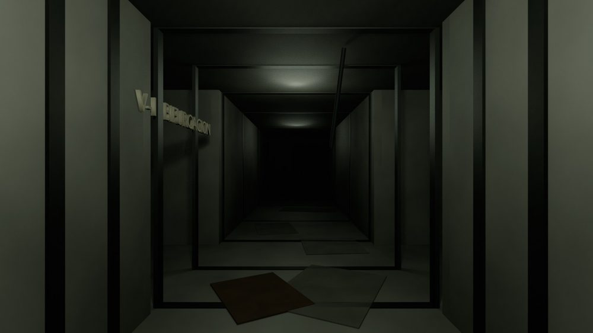
<figcaption>V1 · el cruce: desde aquí se ve hacia qué lado va El Insecto</figcaption>
</figure>
<figure markdown>
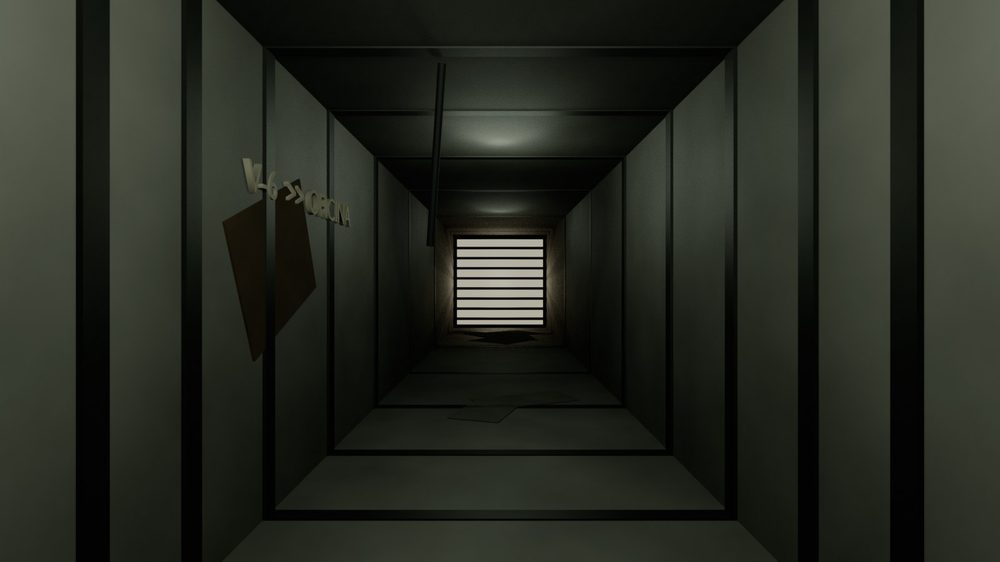
<figcaption>V6 · una de las dos entradas a la oficina</figcaption>
</figure>
</div>

## Antes y después

### La Criogenia (v0.61 → v0.66)

<div class="versiones" markdown>
<figure markdown>
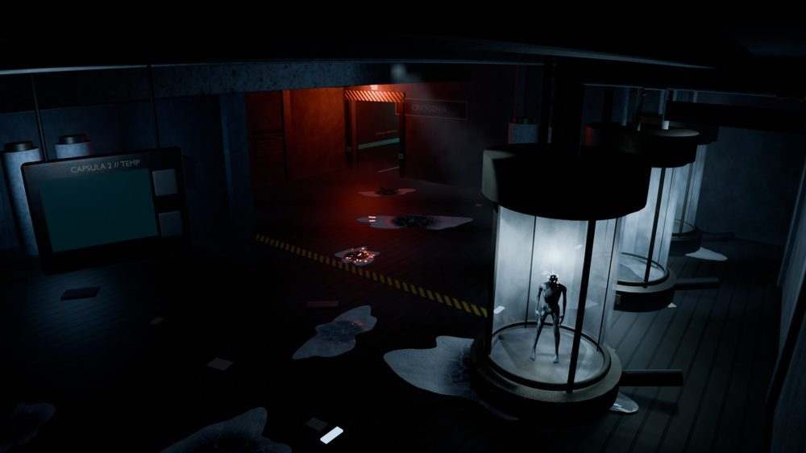
<figcaption>Antes del rediseño de El Congelado</figcaption>
</figure>
<figure markdown>

<figcaption>Ahora</figcaption>
</figure>
</div>

### Las salas de la Ruta B (v0.39)

En la noche 4, si eliges reparar las cámaras, recorres las salas con la linterna. Estas comparativas muestran a la izquierda cómo eran antes y a la derecha cómo quedaron (desliza hacia los lados en el móvil):

<div class="tira" markdown>
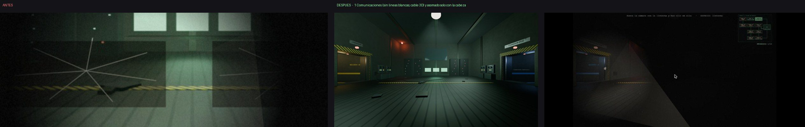
</div>
*Comunicaciones: sin las líneas blancas y con el cable en 3D.*

<div class="tira" markdown>
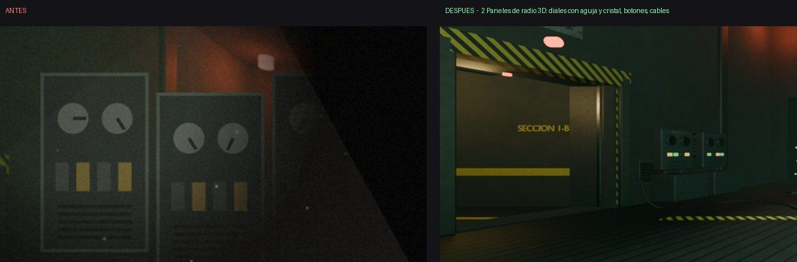
</div>
*Los paneles de radio, en 3D con diales, botones y cables.*

<div class="tira" markdown>
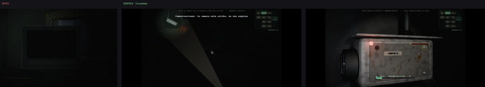
</div>
*Reparar una cámara: buscarla con la linterna, abrirla y desatornillar la tapa.*

<div class="tira" markdown>
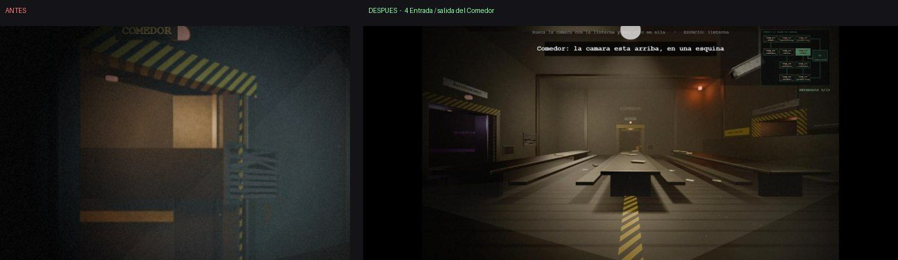
</div>
*La entrada del Comedor.*
