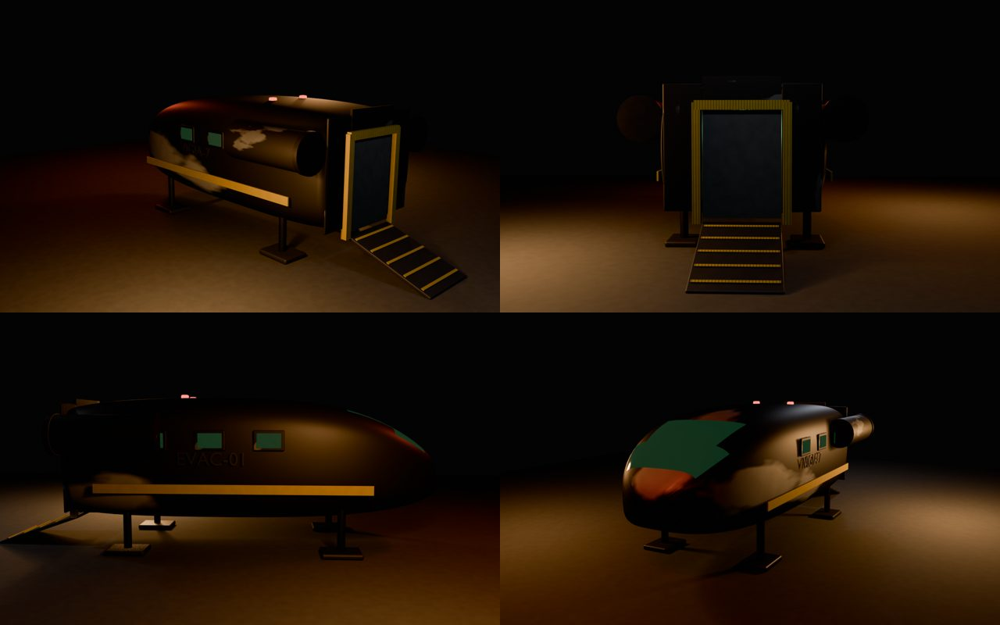
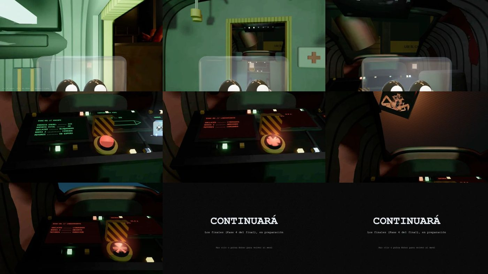
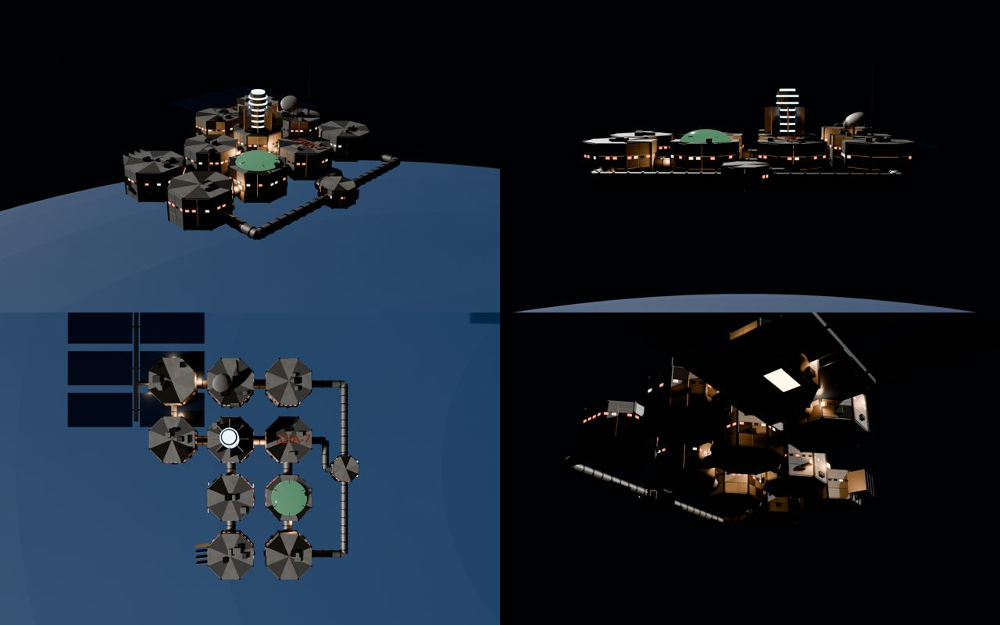
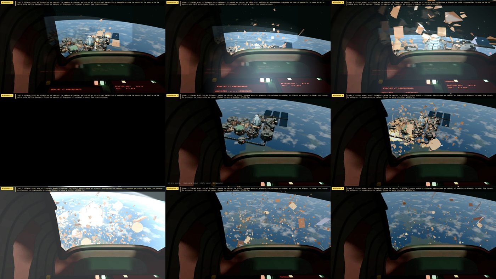

# El final

A las 6:00 de la noche 7 la compuerta de atrás de la oficina revienta. A partir de ahí el juego deja de ser un juego de cámaras: **te levantas, sales de la oficina y huyes por la nave en llamas** hasta el Hangar, con La Aberración detrás.

## Las fases del final

1. **Fase 1 · El estallido.** Sales despedido, te levantas y miras alrededor en 360°. Solo una salida sirve (v1.20 – v1.23).
2. **Fase 2 · La huida.** Del pasillo central al Laboratorio, luego la persecución hasta el Hangar. Desde la **v1.28** se juega en **3D en tiempo real** con ++w++ ++a++ ++s++ ++d++.
3. **Fase 3 · La cabina.** Te encierras en la nave de escape mientras La Aberración golpea la compuerta, te sientas y pulsas el botón de despegue (v1.35).
4. **Fase 4 · Los finales.** La nave se da la vuelta y ves la estación entera sobre el planeta (v1.36).
5. **Fase 5 · Los créditos.** *Pendiente.*

## La nave de escape

La **EVAC-01** es una lanzadera de evacuación de 9 metros, sucia y chamuscada, aparcada en el Hangar.

*Hoja de modelo de la EVAC-01 (v1.34).*

*Dentro de la nave: la bodega, la cabina, el botón rojo y el despegue (v1.35).*

## La VIGIA-7 desde fuera

Para los finales se modeló la estación completa: cada sala es un módulo octogonal y los pasillos son tubos con anillos. Está hecha **en 1.626 piezas** para poder saltar en pedazos.

## Los cuatro finales

El final depende de dos cosas que el juego ha ido guardando: **si Slaimi sigue vivo** y **si El Errante se ha metido en tu cabeza**.

| | El Errante **no** está en tu cabeza | El Errante **está** en tu cabeza |
|---|---|---|
| **Slaimi vivo** | **Final 1** · La estación explota y te alejas en silencio con Slaimi | **Final 2** · Ves su cara en el reflejo y la nave vuelve sola hacia la estación |
| **Sin Slaimi** | **Final 3** · El asiento vacío y tu mano en el cristal | **Final 4** · El final 2, pero sin Slaimi |

!!! abstract "Cómo se decide El Errante en tu cabeza"
    Se activa en la **Ruta A de la noche 4** y, una vez activado, **no se borra nunca** de la partida guardada (`flags.erranteEnCabeza`).
