# La oficina

La oficina es el **Módulo de Control** de la estación: el único sitio seguro de la nave, y donde pasas casi todo el juego. Desde aquí se controlan las compuertas, las luces, las cámaras y la consola de comandos.

## Qué hay en la oficina

- **Dos compuertas**, una a cada lado, con su botón de PUERTA y su botón de LUZ.
- **La consola** con el monitor de cámaras y una pantalla verde para escribir comandos.
- **El ventanal**, con el planeta al fondo.
- **Dos rejillas de ventilación** en la pared de enfrente, por donde entran El Insecto y El Dislocado.
- **El pasillo central**, detrás de ti, sellado en las noches 1 y 2 y abierto desde la noche 3.
- **Las taquillas** de la pared de atrás, para esconderse a las 6:00 de la noche 3.

### Comandos de la consola

| Comando | Para qué sirve |
|---|---|
| `/reset` | Recuperar la energía después de un apagón |
| `get-update` | Ahuyentar a El Insecto al empezar la noche 2 |
| `/InsecP` | Parar una fuga de gas del insecticida |

!!! warning "Los apagones"
    Hay 2 apagones por noche como mínimo. Sin energía no hay luces ni cámaras, y las compuertas **se abren solas** hasta que escribes `/reset`.

## Evolución de la oficina

=== "v0.1 – v0.27 · Dibujada por código"

    En las primeras versiones la oficina se dibujaba entera con código en el `<canvas>`: paredes, compuertas, botones, estrellas y consola. No hay imágenes de esa etapa porque no se usaban archivos de imagen.

    ```js
    // Ejemplo ilustrativo (no es el código real del juego):
    // así se pinta con las funciones del canvas
    ctx.fillStyle = '#1b1f24';
    ctx.fillRect(0, 0, 1600, 900);      // pared
    ctx.fillStyle = luzIzq ? '#ffd54f' : '#3a3a3a';
    ctx.fillRect(60, 420, 40, 40);      // botón de luz izquierda
    ```

=== "v0.28 · Primera oficina 3D"

    Con la nave pasada a un solo modelo de Blender, la oficina tiene por primera vez pared, marcos, ventanal, tuberías y techo en 3D. Las puertas, los botones y la consola se siguen dibujando encima.

    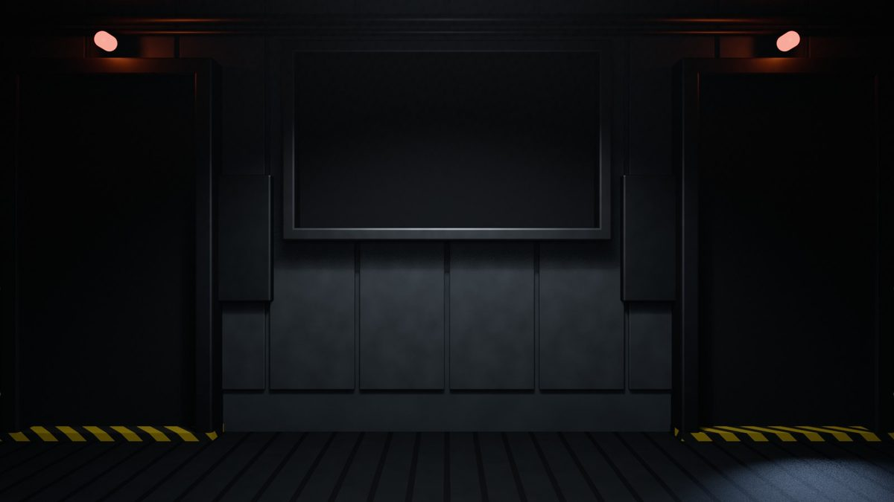

=== "v0.29 · Cuatro paredes"

    La oficina pasa a ser **una sala cuadrada** con el jugador en el centro. Cada pared es una vista y se gira entre ellas.

    <div class="galeria" markdown>
    <figure markdown>
    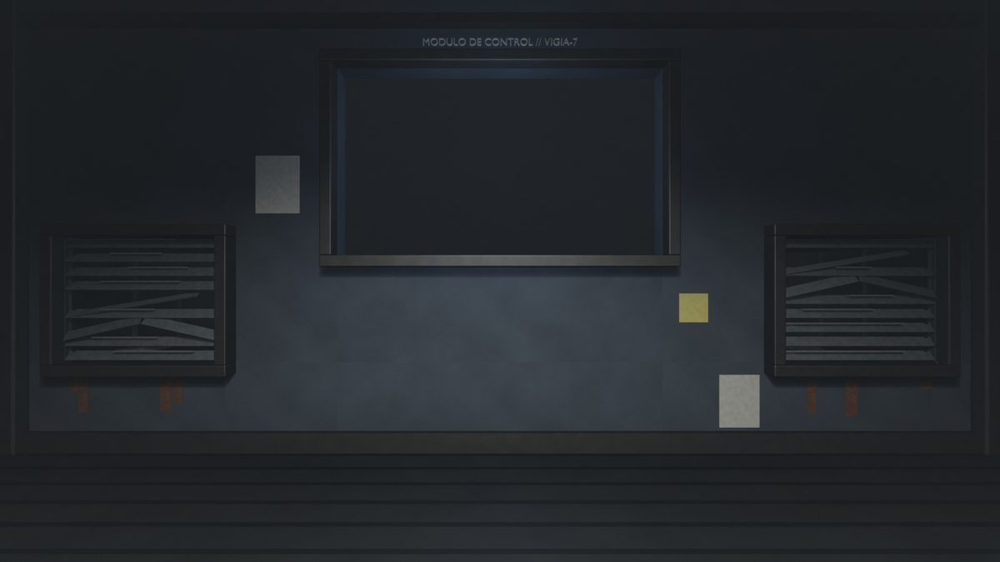
    <figcaption>Frente: el monitor y las rejillas</figcaption>
    </figure>
    <figure markdown>
    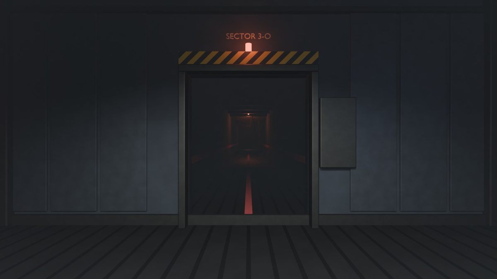
    <figcaption>Izquierda: la compuerta</figcaption>
    </figure>
    <figure markdown>
    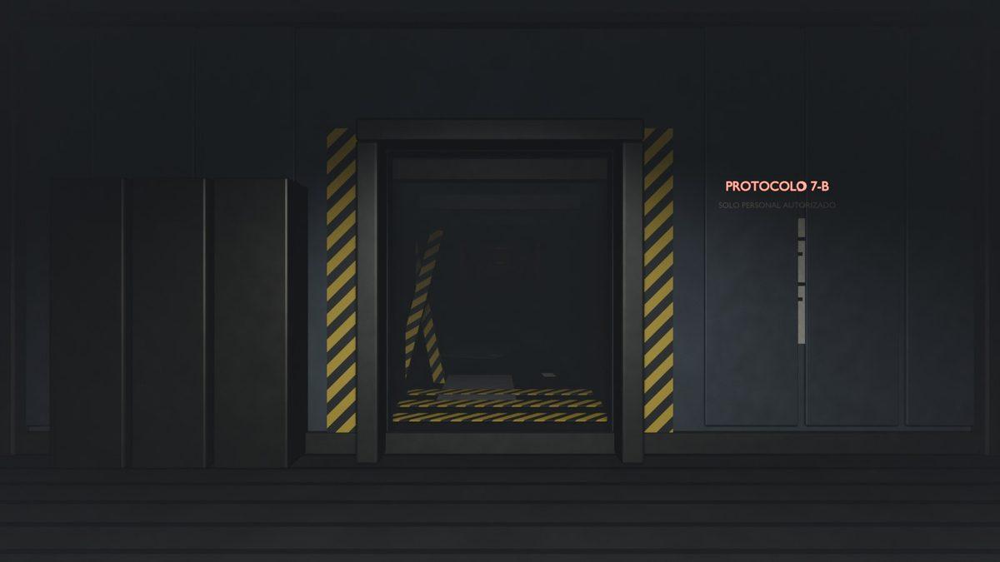
    <figcaption>Atrás: el pasillo central</figcaption>
    </figure>
    <figure markdown>
    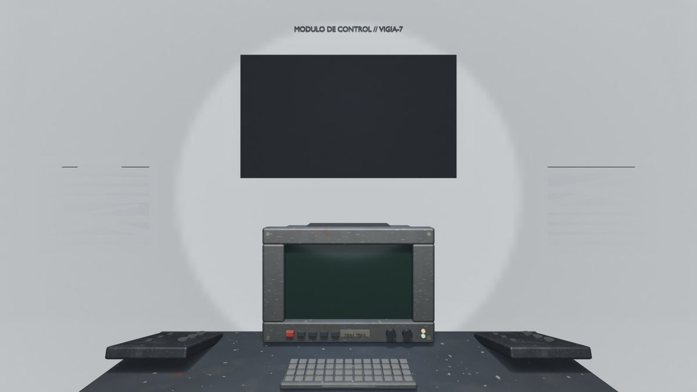
    <figcaption>La consola en 3D (v0.55)</figcaption>
    </figure>
    </div>

=== "v1.00 – v1.11 · La oficina de Blender"

    La versión actual. Toda la oficina sale **del mismo modelo de Blender y de la misma cámara**, de la noche 1 a la 7, con las cuatro vistas.

    <div class="galeria" markdown>
    <figure markdown>
    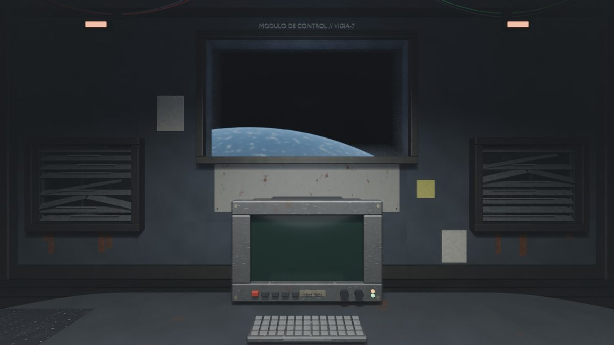
    <figcaption>Frente</figcaption>
    </figure>
    <figure markdown>
    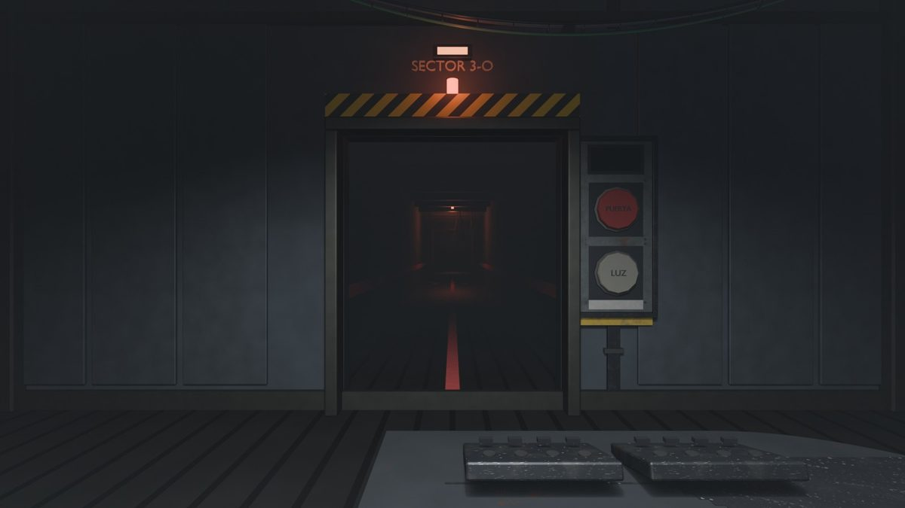
    <figcaption>Izquierda</figcaption>
    </figure>
    <figure markdown>
    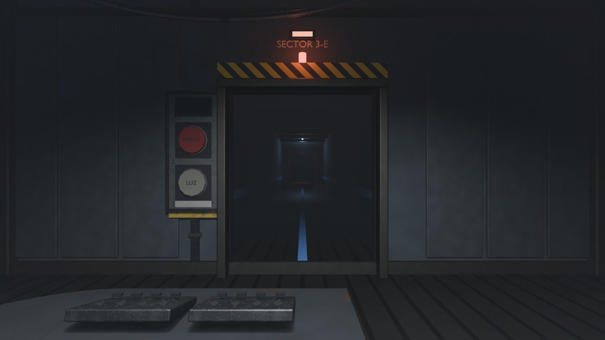
    <figcaption>Derecha</figcaption>
    </figure>
    <figure markdown>
    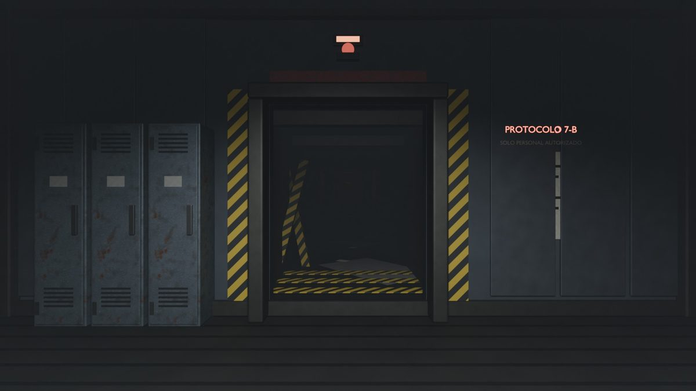
    <figcaption>Atrás: las taquillas y el pasillo central</figcaption>
    </figure>
    </div>

## Los estados de la oficina

La misma oficina cambia según lo que pasa en la noche. En la noche 7 **se va rompiendo por estados**: a las 4:00 llegan un impacto en estrella, cables con chispas y humo fino; a las 4:30, escombros y una llama en la caja eléctrica; y a partir de las 5:00, grietas y fuego.

<div class="galeria" markdown>
<figure markdown>

<figcaption>Normal</figcaption>
</figure>
<figure markdown>
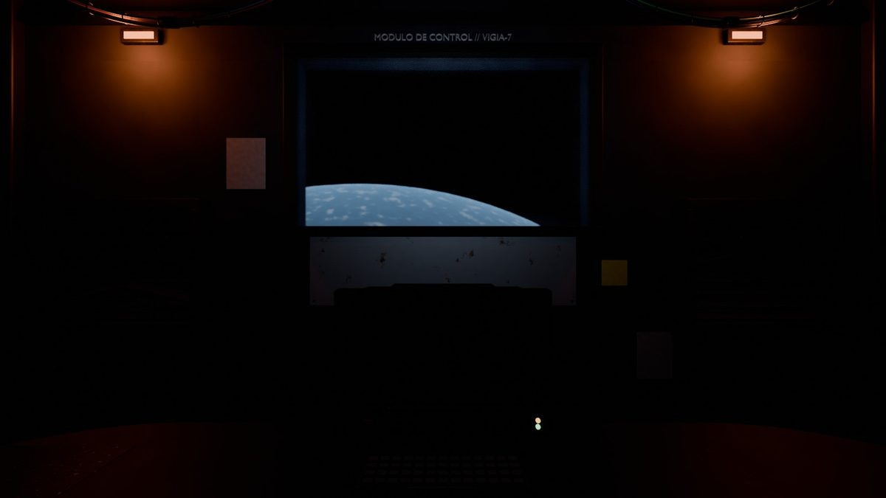
<figcaption>Apagón: solo queda la luz de emergencia</figcaption>
</figure>
<figure markdown>
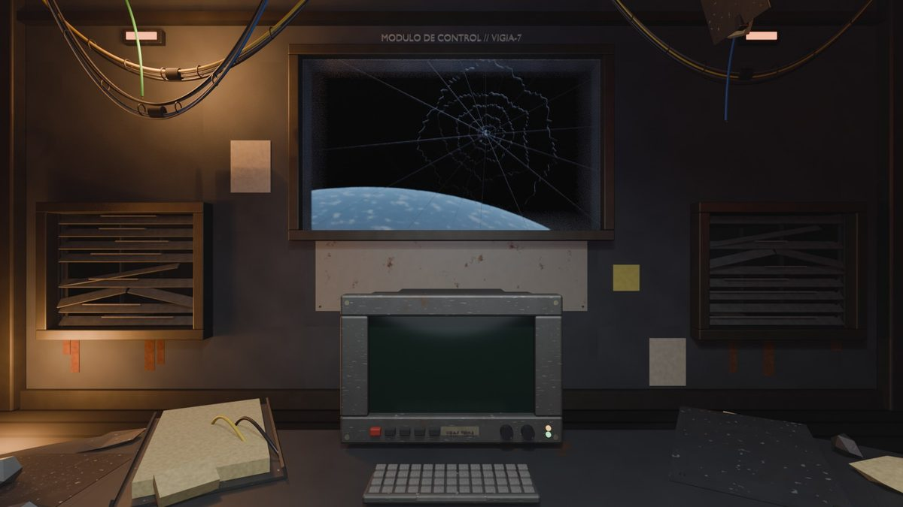
<figcaption>Noche 7, 5:00 AM</figcaption>
</figure>
<figure markdown>
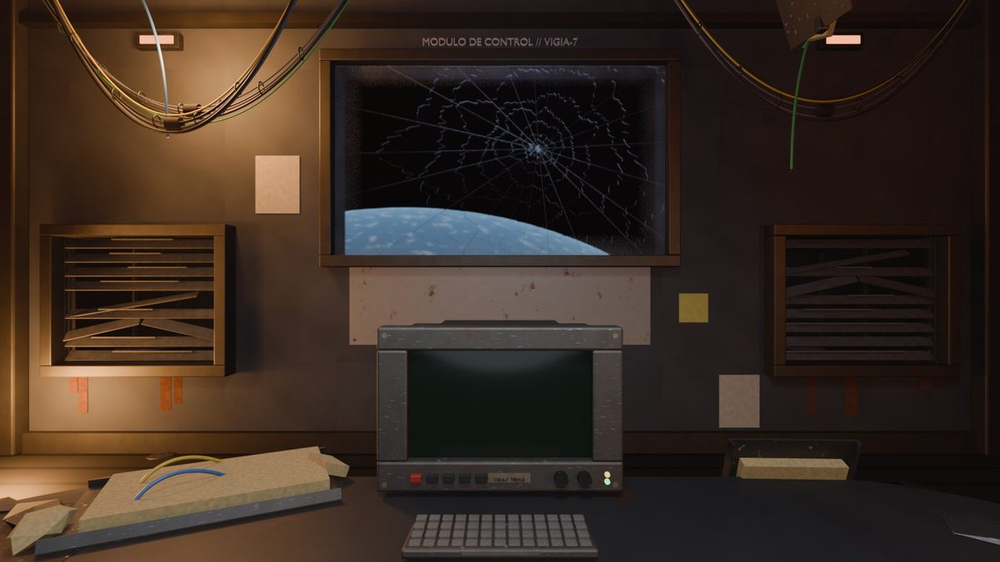
<figcaption>Noche 7, justo antes del final</figcaption>
</figure>
</div>

## Comparativa: la oficina en cada noche

En la v1.11 se unificó la oficina. Esta captura de comprobación muestra las cuatro vistas en las noches 1, 4 y 7:

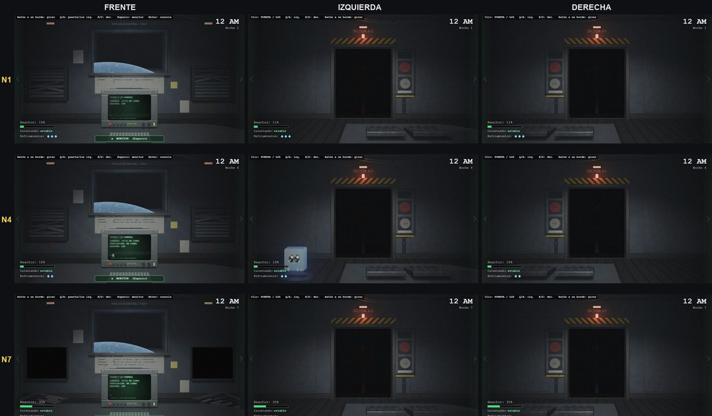

Y esta, la luz de las compuertas y el apagón en cada noche:

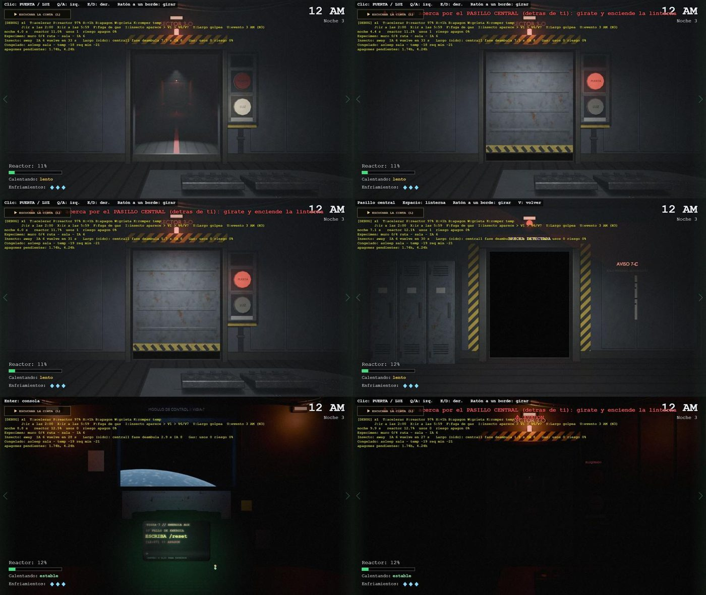

!!! bug "La pared blanca (v0.65)"
    Durante unas horas la pared del frente se veía **blanca**. El render de la consola se cargaba en `.jpg`, que no tiene transparencia, y su fondo blanco tapaba la pared entera. Se arregló usando la versión `.webp` con transparencia.
