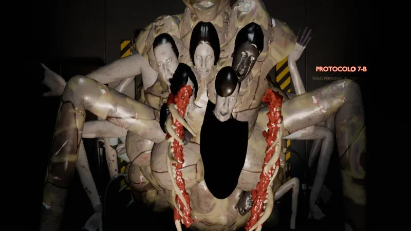
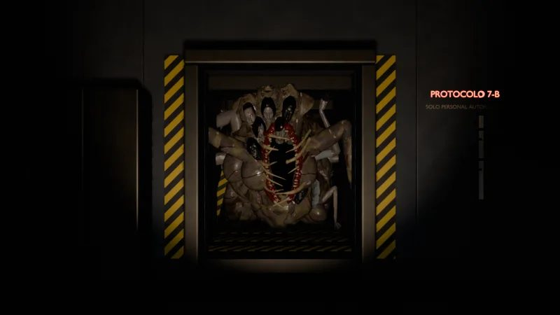

# La Aberración

**El jefe final.** Aparece al terminar la noche 6, cuando rompe la pared de la CAM 02, y ataca en la noche 7.

## Concepto

El **primer experimento de la nave**, encerrado antes que todos los demás en una sala secreta detrás del Laboratorio. Es una masa enorme hecha con los tripulantes fallidos de la criogenia, fundidos entre sí.

El Errante y El Dislocado la obedecen porque salieron de ella. El juego no lo explica, solo lo insinúa: entre sus brazos hay uno con la manga gris azulada del uniforme de El Errante.

## El diseño aprobado

La tercera hoja de modelo se aprobó el **27 de octubre** con un «el diseño está perfecto»:

- Un **torso enorme sin cabeza**, encorvado, con los hombros aplastados contra el techo (4,2 m) y una masa de cuerpos detrás de unos 8 m.
- El pecho es un **desgarro vertical** con dientes humanos y costillas irregulares. Cada lado de la boca cuelga de una mandíbula que se abre hacia fuera.
- En el sitio de la cabeza, un **racimo de 5 caras**, y 4 más alrededor del desgarro: personas distintas que gritan sin voz.
- Se sostiene sobre **unos 30 brazos humanos** de tamaños distintos, con la mano plana en el suelo, las paredes y el techo.

!!! quote "Lo que tiene que transmitir"
    Nunca se ve entera. Se mueven las partes que no deberían: un brazo que se estira solo, los dedos de otro que tamborilean. Las caras parpadean a destiempo. Es, con diferencia, la criatura que más miedo tiene que dar.

## Sus versiones

| Versión | Juego | Cómo era |
|---|---|---|
| Hoja 1 | v0.72 | Un bulto de unos 4,5 m de ancho con 10 brazos y una corona de 4 caras alrededor de una sola boca |
| Hoja 2 | v0.73 | Un torso enorme sin cabeza con la masa de cuerpos detrás, 12 brazos y 6 caras hundidas en la carne |
| **Hoja 3** | **aprobada tras la v0.74** | **El diseño aprobado**: el desgarro del pecho, 9 caras y unos 30 brazos |

## En el juego

<figure markdown>

<figcaption>Llegando a la compuerta del pasillo central</figcaption>
</figure>
<figure markdown>

<figcaption>Su susto</figcaption>
</figure>

- **Noche 6:** a las 6:00 rompe la pared de la CAM 02 y se acerca a la cámara (v0.73 – v0.81).
- **Noche 7:** llega por el pasillo central, por las cámaras y por las puertas de los lados. La compuerta del pasillo no se cierra: hay que **frenarla alumbrándola** todo el rato (v0.91 – v0.94).
- **El final:** revienta la pared del Laboratorio, te persigue en 3D por la nave y golpea la compuerta de la nave de escape (v1.27 – v1.35).
