# Los enemigos

Cada criatura con su mecánica y **todas sus versiones**. Las primeras versiones en 3D (de la v0.27 a la v0.51) tenían casi todas una «cabeza de huevo» lisa; en la **v0.52** se rediseñaron todas a la vez y después cada una se pulió por separado.

!!! warning "Aviso"
    Las imágenes de las versiones actuales son fotogramas de los **sustos** (*jumpscares*) del juego.

---

## El Congelado

**Noche:** desde la 1 · **Dónde:** Criogenia (CAM 05) · **Mecánica:** mantener la temperatura que pide la cápsula.

Un tripulante que entró en criosueño durante el experimento y nunca terminó de despertarse. Su cuerpo sigue medio congelado y el calor le duele: por eso exige una temperatura concreta. Si no se la das, sale corriendo por las cámaras hasta tu compuerta.

=== "Versión 1 · v0.30"

    

    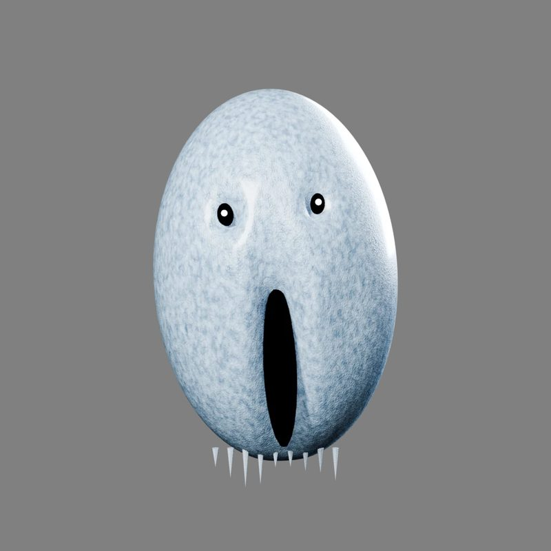
    

    Primer modelo en 3D, con la cara lisa de «huevo» y carámbanos colgando de la barbilla.

=== "Versión 2 · v0.61"

    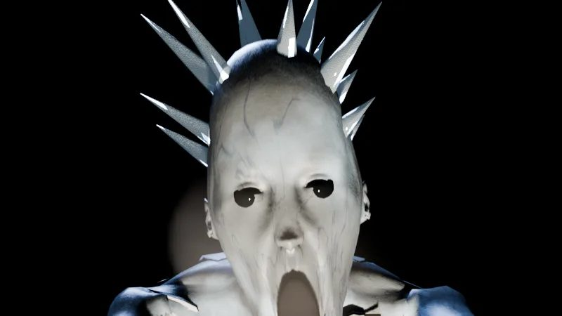

    La cabeza de la primera versión con **pinchos de hielo**. Se usó en todas sus apariciones de la v0.61 a la v0.65.

=== "Versión 3 · v0.66 (actual)"

    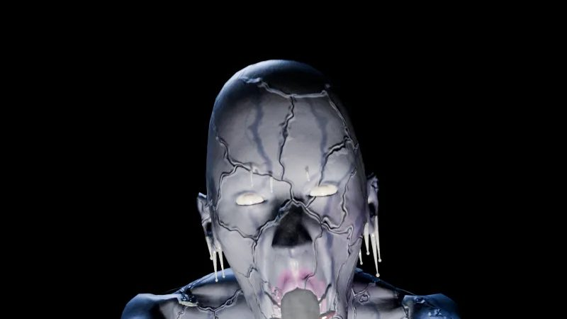

    **«El Congelado 10/10»**, aprobado en la tercera hoja de modelo:

    - piel azul oscura y **cuarteada**, con escarcha solo en los bordes de las grietas;
    - carámbanos en las cejas, la barbilla y las orejas, y córnea helada;
    - boca larga con los labios agrietados;
    - pulsera de paciente, jirones de la bata y tubos colgando de la espalda.

    Además corre por toda su ruta dejando un **rastro de escarcha** que se derrite en 90 s, y tiene **3 variantes del salto**.

---

## El Espécimen

**Noche:** desde la 1 · **Dónde:** detrás del muro de la CAM 02 · **Mecánica:** rompe el muro poco a poco y recorre una de dos rutas hasta una compuerta; hay que cerrarla cuando llega.

El experimento estrella del laboratorio, el que tenían emparedado.

=== "Versión 1 · v0.30"

    

    <figure markdown>
    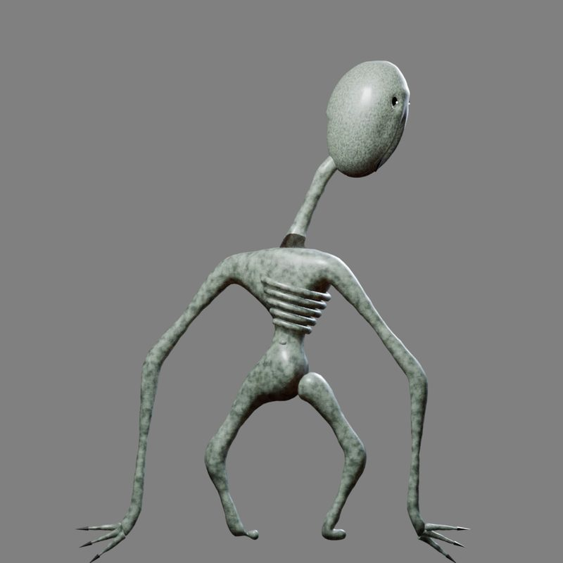
    <figcaption>Cuerpo</figcaption>
    </figure>
    <figure markdown>
    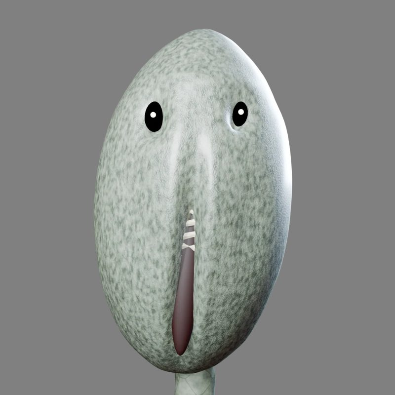
    <figcaption>Cara</figcaption>
    </figure>
    

    Cuerpo esquelético, encorvado y con la cabeza alargada sobre un cuello muy fino.

=== "Versión 2 · v0.58 (actual)"

    

    <figure markdown>
    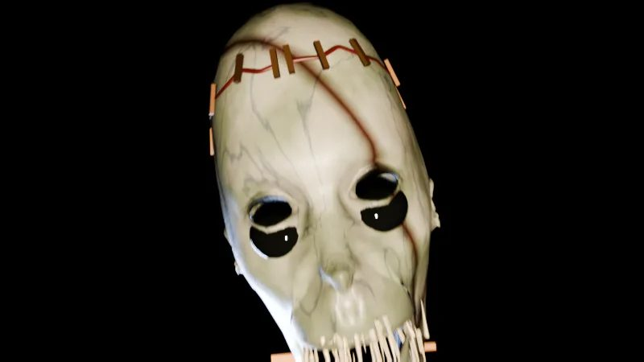
    <figcaption>Susto</figcaption>
    </figure>
    <figure markdown>
    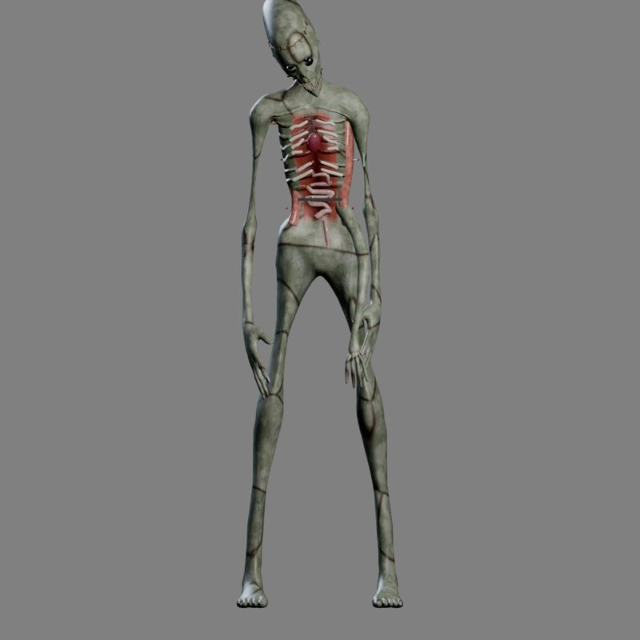
    <figcaption>Cuerpo</figcaption>
    </figure>
    

    **Un alienígena mutado abierto en autopsia**: cráneo largo con grapas, ojos negros, dientes de aguja y el pecho abierto con las costillas serradas.

---

## El Largo

**Noche:** en la 2.5 y desde la 3 · **Dónde:** salas, pasillo central y puertas · **Mecánica:** se guía **por el sonido**; los golpes metálicos en una sala vecina lo alejan.

Un sujeto de experimentos de crecimiento que no paró de crecer. Mide 3 metros, casi no ve y lo oye todo. Es el cazador principal de la nave.

=== "Versión 1 · v0.30"

    

    <figure markdown>
    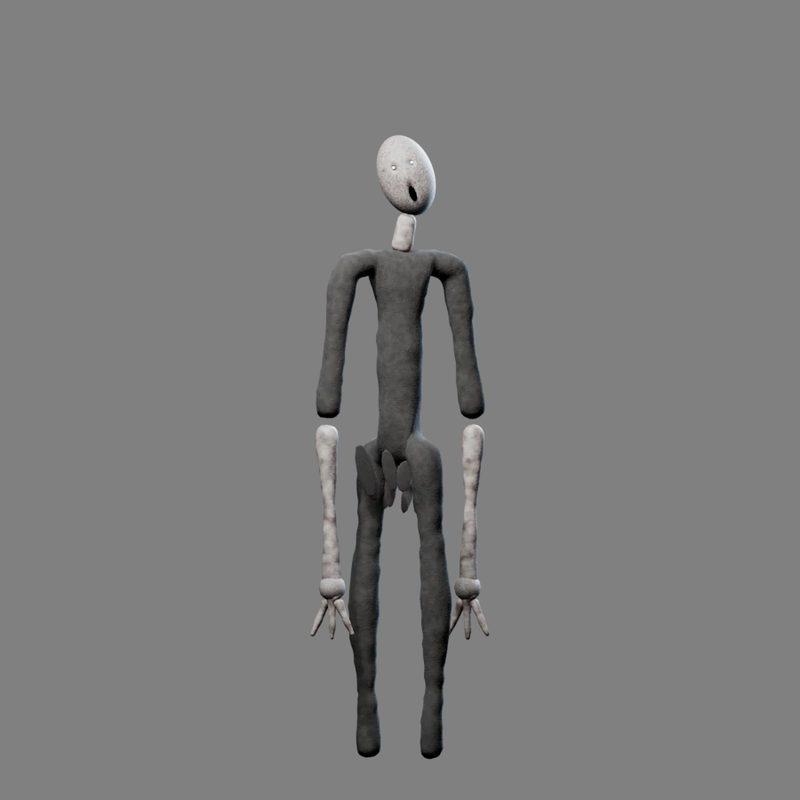
    <figcaption>Cuerpo</figcaption>
    </figure>
    <figure markdown>
    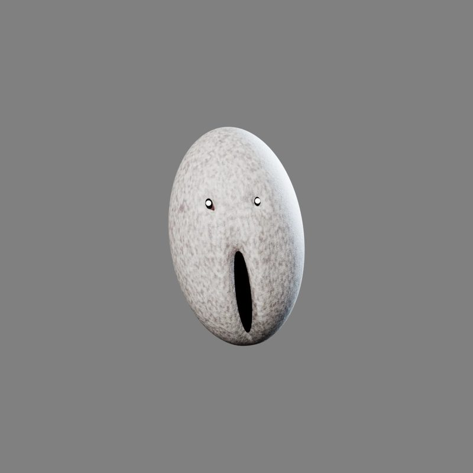
    <figcaption>Cara</figcaption>
    </figure>
    

    Un maniquí alto y delgado con la cara de «huevo». El registro de cambios lo resume así: «parecía un duende».

=== "Versión 2 · v0.55 (actual)"

    

    <figure markdown>
    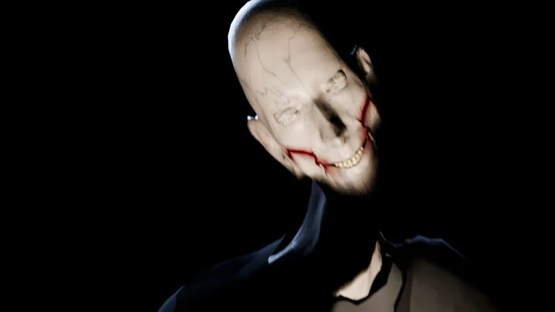
    <figcaption>Susto</figcaption>
    </figure>
    <figure markdown>
    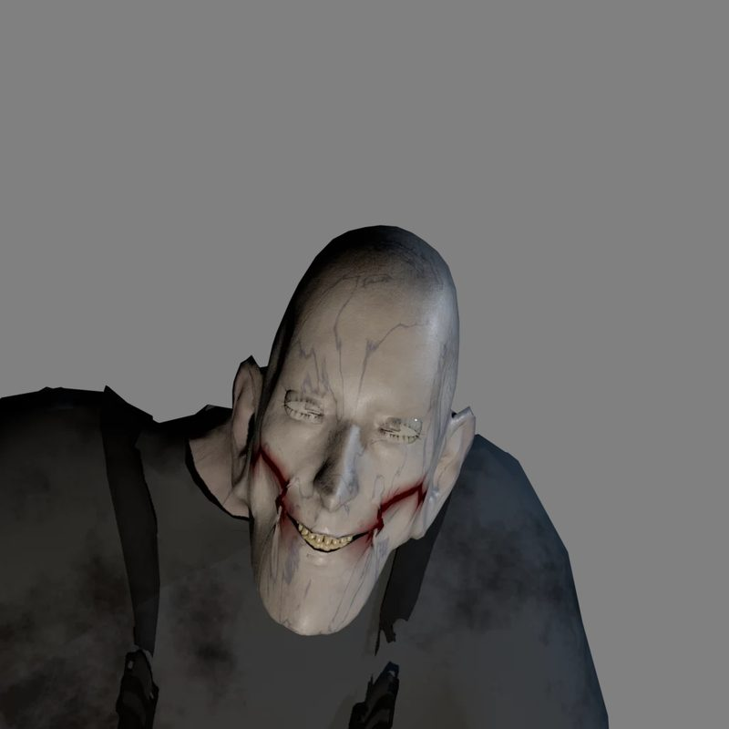
    <figcaption>Cara</figcaption>
    </figure>
    

    - Mono de trabajo que se le ha quedado pequeño, **reventado por las costuras**.
    - Brazos con anatomía real: codo huesudo que nunca va recto y manos enormes.
    - Cara larga y demacrada, con los ojos hundidos y lechosos.
    - La sonrisa «rasgada»: dientes amarillos y comisuras cortadas hacia las orejas.

    En la **v0.59** aprendió a **romper las cámaras a puñetazos**.

---

## El Insecto

**Noche:** desde la 2 · **Dónde:** conductos de ventilación · **Mecánica:** se le ahuyenta con insecticida en V6 o V7.

El único experimento que no era humano: una plaga de laboratorio que creció. Al principio se llamaba «El Rastrero»; los dos personajes se unieron en uno solo el 21 de octubre.

=== "Versión 1 · v0.27"

    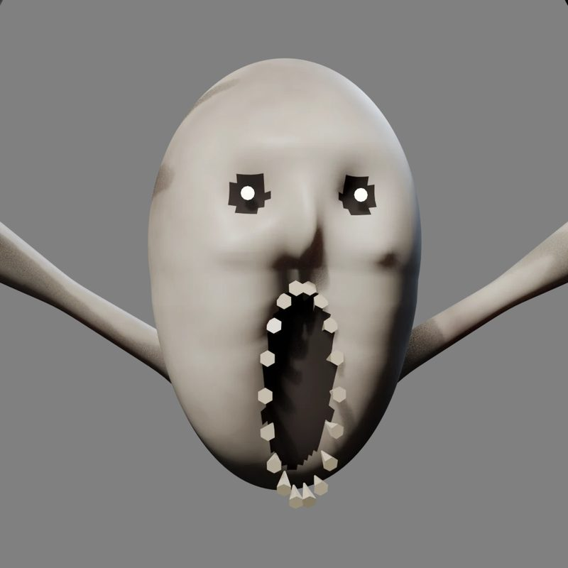

    El **primer enemigo modelado en 3D** del juego: torso larguísimo pegado al suelo, extremidades finísimas y una cara pequeña y lisa con la boca abierta de par en par.

=== "Versión 2 · v0.52 (actual)"

    

    <figure markdown>
    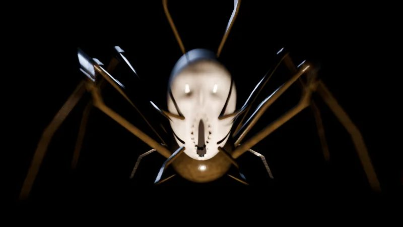
    <figcaption>Susto</figcaption>
    </figure>
    <figure markdown>
    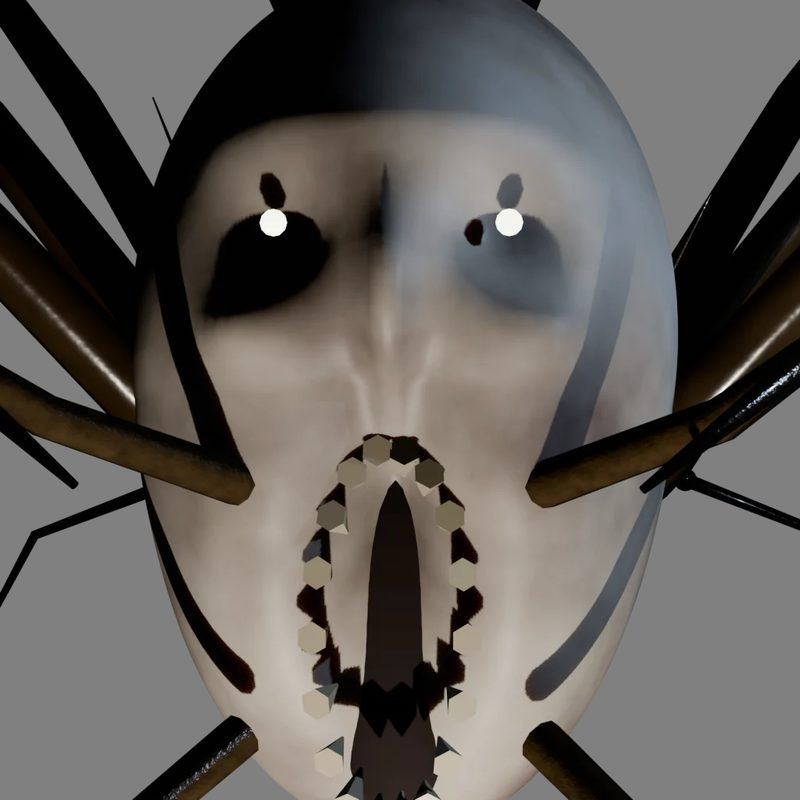
    <figcaption>Cara</figcaption>
    </figure>
    

    Conserva la cara con el **anillo de dientes**, pero con cuerpo de insecto de verdad: caparazón de anillos, seis patas altas, antenas larguísimas y cuatro mandíbulas.

---

## El Errante

**Noche:** se ve en la 4 (Ruta B) y está activo desde la 5 · **Dónde:** puertas y cámaras · **Mecánica:** si lo miras 7 segundos seguidos, **apaga todas las cámaras**.

La cosa a la que todo lo demás tiene miedo. No mata: rompe la mente. Lleva el uniforme y los ojos de alguien de la tripulación. Nunca se le ve moverse: solo cambia de sitio entre fotogramas.

=== "Versión 1 · v0.41"

    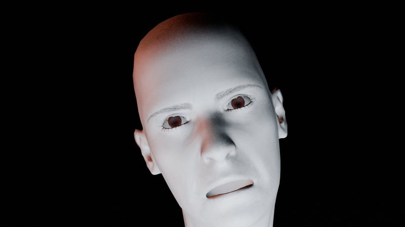

    El concepto **«El Que Mira»**. En la v0.42 su creador le puso el nombre definitivo: **El Errante**.

=== "Versión 2 · v0.56 (actual)"

    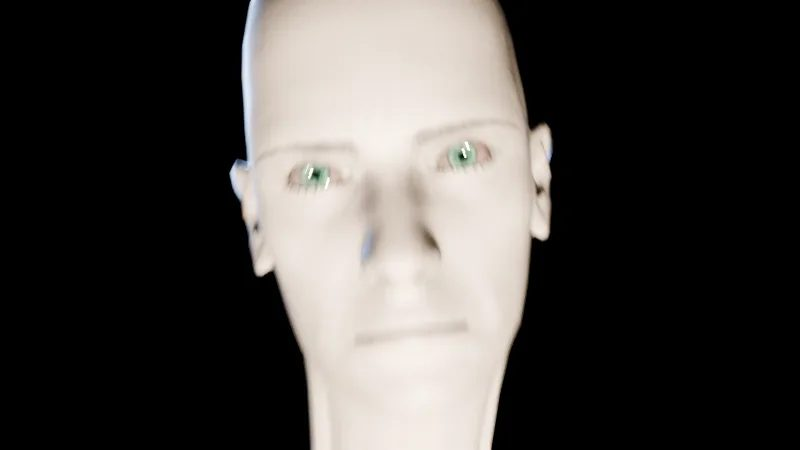

    El mismo diseño, pero con **ojos nuevos**: abiertos, húmedos y vivos, con iris y pupila. Antes salían blancos.

---

## El Dislocado

**Noche:** desde la 5 · **Dónde:** conductos y rejillas de la oficina · **Mecánica:** rompe las rejillas a las 2 y a las 4 AM; se le aleja alumbrando la rejilla.

Un tripulante partido por la mitad que sigue vivo. Se arrastra con los brazos, rápido y a tirones. Es el enemigo más grotesco del juego.

=== "Versión 1 · v0.46"

    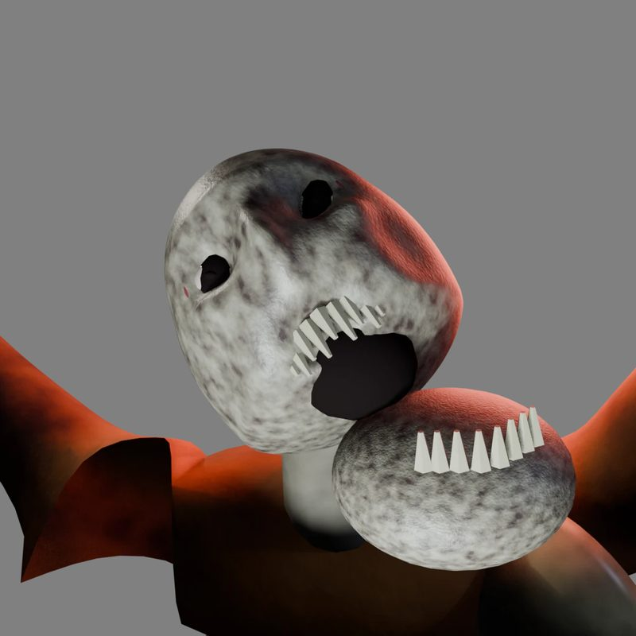

    La primera versión, con una mandíbula enorme llena de dientes.

=== "Versión 2 · v0.52"

    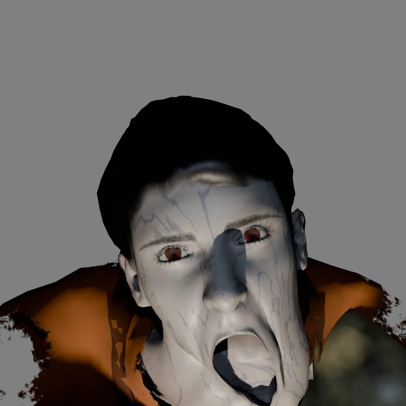

    El rediseño lo vuelve **humano**: un técnico con la mandíbula desencajada y restos del uniforme.

=== "Versión 3 · v0.60 (actual)"

    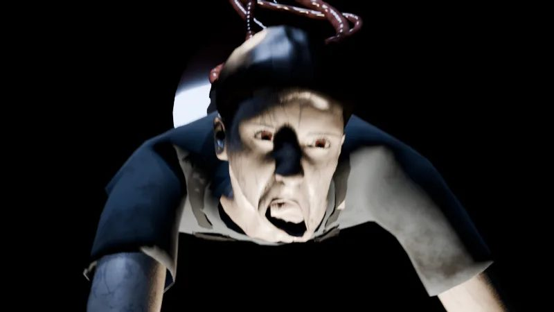

    **Piel nueva**, con poros, suciedad y brillo mojado. El diseño no cambia, pero el corte de la cintura se lee mucho mejor.

---

## Resumen de versiones

| Personaje | Versión 1 | Versión 2 | Versión 3 |
|---|---|---|---|
| El Congelado | v0.30 | v0.61 · pinchos de hielo | **v0.66** · piel cuarteada |
| El Espécimen | v0.30 | **v0.58** · alienígena | — |
| El Largo | v0.30 | **v0.55** · sonrisa rasgada | — |
| El Insecto | v0.27 | **v0.52** · insecto de verdad | — |
| El Errante | v0.41 | **v0.56** · ojos nuevos | — |
| El Dislocado | v0.46 | v0.52 · humano | **v0.60** · piel nueva |
