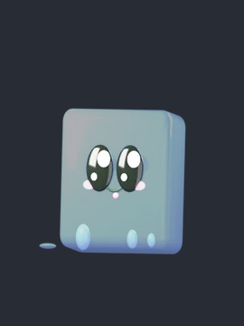
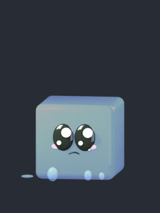
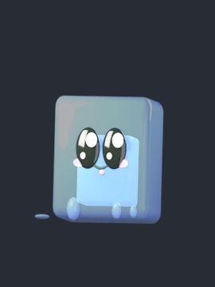

# Slaimi y los humanos

## Slaimi

**El único aliado del juego.** Un experimento fallido que salió bien: una criatura de gelatina inofensiva y cariñosa.

<figure markdown>
{ width="220" }
<figcaption>Siguiéndote</figcaption>
</figure>
<figure markdown>
{ width="220" }
<figcaption>Triste</figcaption>
</figure>

**Cómo ayuda:** aparece en la **Ruta B de la noche 4**. Si lo salvas, te acompaña en las noches siguientes: salta hacia el lado del enemigo más cercano y su luz te ayuda a oscuras.

!!! note "Regla clave de su diseño"
    Slaimi **nunca debe dar miedo ni resultar asqueroso**, ni siquiera muerto: debe dar pena. El contraste con el resto de criaturas es lo que hace que la gente se encariñe con él.

### Sus versiones

1. **v0.35 · 10 diseños en 3D** para elegir uno.
2. **v0.36 · 20 diseños más.**
3. **v0.37 · Slaimi «Arándano».**
4. **v0.52 · el diseño final, sin brote**: un cubito gelatinoso translúcido con ojos grandes y brillantes.

<figure markdown>
{ width="220" }
<figcaption>Antes de la v0.52</figcaption>
</figure>
<figure markdown>
{ width="220" }
<figcaption>Ahora</figcaption>
</figure>

### Sus expresiones

| Expresión | Cómo se ve |
|---|---|
| Contento | Salta, se estira al subir y se aplasta al caer |
| Asustado | Tiembla, se encoge y su luz parpadea |
| Triste | Se queda quieto, con los ojos llorosos |
| Congelado | Atrapado en hielo, con la luz apagándose |
| Muerto | Sin brillo, deshecho y gris |

!!! tip "Slaimi decide el final"
    Que Slaimi siga vivo al llegar a la noche 7 cambia cuál de los [cuatro finales](../nave/final.md#los-cuatro-finales) ves.

## Los humanos

Los humanos de la nave **casi nunca se ven**: se les conoce por su voz.

El hombre de la cinta
:   Técnico de mantenimiento de unos 45 años. Su voz, grave y cansada, está cada vez más rota noche a noche. Habla en las cintas de los turnos de cámaras. Nunca se le ve: su único rastro es la grabadora abollada.

La mujer
:   Científica del laboratorio, de unos 30 años. Habla en voz baja, nerviosa pero decidida, y sabe más de los experimentos de lo que cuenta. Solo habla en los minijuegos y quiere escapar de la nave.

El protagonista
:   El vigilante. Nunca se le ve y solo dice una frase en todo el juego, en la noche 4: *«Estoy cansado, debo ir a un sitio seguro»*.

La tripulación
:   Entre 6 y 8 tripulantes (técnico, médico, científico, seguridad, cocinero, piloto) que aparecen en las **alucinaciones de las 3 AM**. Uno de ellos tiene los ojos que ahora lleva El Errante.

!!! info "La norma de voces (v0.17)"
    El hombre solo habla en los **turnos de cámaras** y la mujer solo en los **minijuegos**. Las voces se generan con *edge-tts*.
